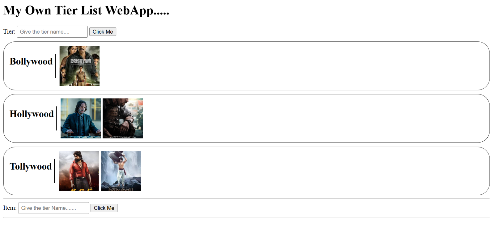

# My Own Tier List Web App

A simple, browser-based tier list maker for organizing image-based items into custom categories. Create tiers, add images from URLs, and drag items between the gallery and your tiers.

## Screenshot



## Features

- Create custom tier rows with your own names.
- Add images to the item gallery using an image URL.
- Drag gallery images into a tier.
- Double-click an image in a tier to move it back to the gallery.
- Use the app directly in a modern web browser; no build tools or package installation are required.

## Built With

- HTML5 for the page structure and forms.
- CSS3 for the tier rows, image tiles, and layout.
- Vanilla JavaScript for creating tiers and images and handling drag-and-drop interactions.

## Project Structure

```text
MyTierApplication/
├── index.html                 # App page and initial gallery item
├── styles.css                 # Layout and visual styles
├── script.js                  # Tier, image, and drag-and-drop behavior
└── screenshots/
    └── tier-list-app.png      # Application screenshot
```

## Getting Started

### Run locally

1. Download or clone this project.
2. Open `index.html` in a modern web browser.
3. Start creating tiers and adding images.

The HTML references `styles.css` and `script.js` from the same directory, so keep those files alongside `index.html`. There are no dependencies to install and no build step.

## How to Use

1. Enter a name in the **Tier** field and select **Click Me** to create a tier.
2. Enter a direct image URL in the **Item** field and select **Click Me** to add it to the gallery.
3. Drag an image from the gallery into the tier where you want it.
4. Double-click an image in a tier to return it to the gallery.

The page includes one initial gallery image. New tiers and images are added while the page is open.

## Implementation Notes

- `index.html` provides the forms, tier-list container, initial gallery item, and links to the stylesheet and JavaScript.
- `styles.css` defines the bordered tier rows, image tiles, and horizontal gallery and tier-item layouts.
- `script.js` creates tier rows and image tiles, checks that the text fields are not empty, and handles the drag-and-drop and double-click interactions.
- Images are loaded from the URLs supplied by the user. The initial gallery image also uses an external image URL.

## Limitations

- Tiers and added images are held only in the current page session. Reloading or closing the page clears changes.
- Image URLs must be reachable by the browser and point to image content. The app does not upload image files.
- The initial gallery image is hosted externally and may be unavailable if its source URL changes.